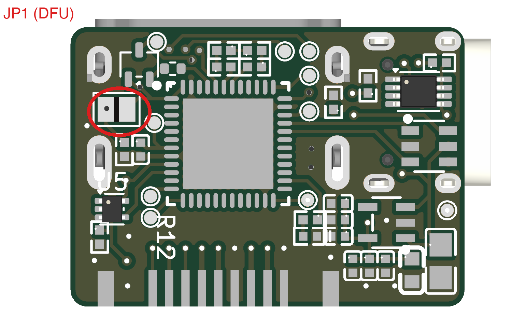
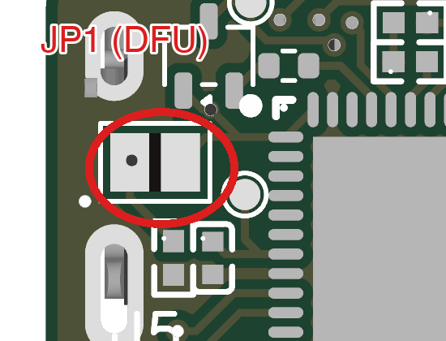
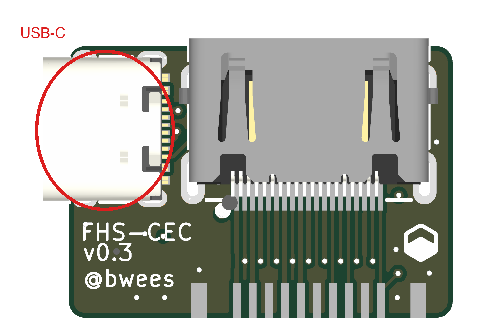

# FHS-CEC v0.3 Programming Instructions

Programming over USB, after assembly. No debug probe needed.

## Order details

| Item | Value |
|---|---|
| Part to program | U1, STM32F072CBU6 |
| Interface | USB-C connector (J3), STM32 ROM USB DFU bootloader |
| Boot mode | Short jumper JP1 while plugging in USB |
| Firmware file | `fhs-cec-firmware.hex` (also `fhs-cec-firmware.bin`, start address `0x08000000`) |
| Board photos | `images/` |

## Equipment

- Windows PC with [STM32CubeProgrammer](https://www.st.com/en/development-tools/stm32cubeprog.html) (free, from ST)
- USB-C cable
- Tweezers or a wire to short JP1

## Find JP1

JP1 is a two-pad solder jumper on the **bottom** side, next to the large chip (U1). It has no
silkscreen label. Leave it open: do not solder it closed.

The USB-C connector (J3) is on the **top** side.

## Program one board

1. Short the two JP1 pads with tweezers.
2. Keep the pads shorted and plug the USB-C cable into the board.
3. Remove the tweezers. The board stays in programming mode until it is unplugged.
4. Open STM32CubeProgrammer. Select **USB** in the connection panel, press refresh, and pick the
   port that appears (`USB1`). Press **Connect**.
   - Windows lists the board as **STM32 BOOTLOADER** (USB ID `0483:DF11`).
   - If no port appears, unplug and repeat from step 1.
5. Go to **Erasing & Programming**. Browse to `fhs-cec-firmware.hex`.
6. Tick **Verify programming**. Press **Start Programming**.
7. Wait for **File download complete** and **Download verified successfully**.
8. Unplug the board.

Command-line alternative:

    STM32_Programmer_CLI -c port=USB1 -w fhs-cec-firmware.hex -v -g

## Check the board

Plug the board in again **without** shorting JP1.

- Pass: Windows Device Manager shows a new USB device named **FHS CEC Adapter** (USB ID
  `3A4C:4663`). A missing driver warning on this device is expected.
- Fail: the board shows as **STM32 BOOTLOADER** again, or nothing appears. Program it again.

The LED stays off during this test. That is expected.
